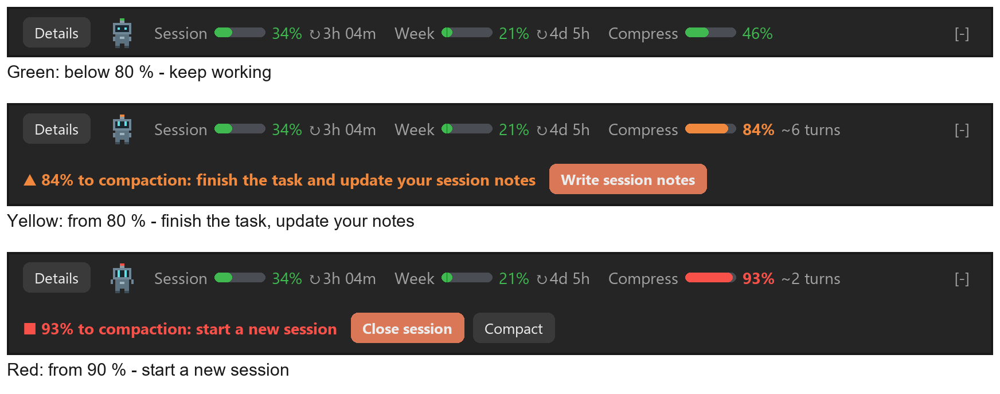
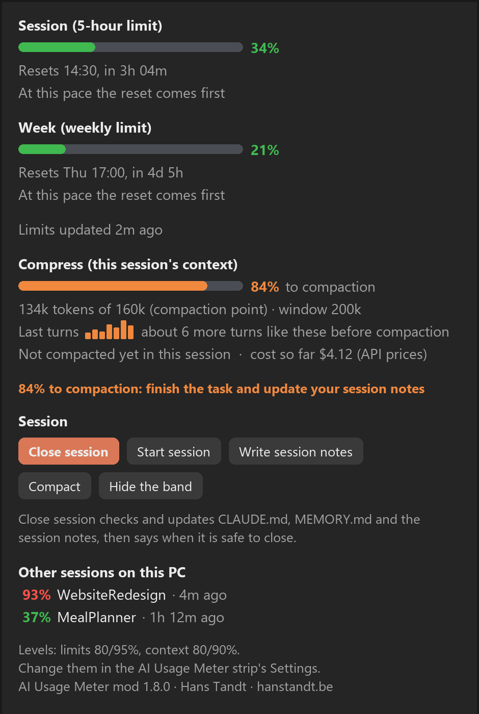

# AI Usage Meter mod for Claude Code

Your Claude 5-hour and weekly limits, and how full your session's context is, inside Claude Code itself: in a band above the prompt, in a details pane, and in short messages. Claude Code makes room for it, so it never covers your work. It works in the desktop app's Code tab and in the terminal.

> Unofficial community project. Not affiliated with, endorsed by or sponsored by Anthropic. "Claude" is a trademark of Anthropic.

Version 1.8.0 · Made by Hans Tandt · MIT licence · [What's new](CHANGELOG.md)



## Manual

The manual (11–12 pages) is in [`docs/out`](docs/out), as PDF and Word: [English](docs/out/AI_Usage_Meter_Mod_Manual_EN.pdf) · [Français](docs/out/AI_Usage_Meter_Mod_Manual_FR.pdf) · [Nederlands](docs/out/AI_Usage_Meter_Mod_Manual_NL.pdf) · [Deutsch](docs/out/AI_Usage_Meter_Mod_Manual_DE.pdf). Its text is in `docs/text_XX.json`; `py docs/make_content.py` turns it into `docs/content_XX.json`, which the general-report-builder skill builds into the PDF and Word files.

## What it shows

- **The band above the prompt**: **Session** (5-hour limit), **Week** and **Compress** (this session's context, measured against the point where compaction starts), each with a bar, the percentage and the time to reset, plus an estimate of how many more turns like the last few fit before compaction. It adds `5h: 100% in 1h 20m` when you are on pace to run out before the reset, `limits updated 1h 10m ago` when the figures are old, and `other: MyProject 92%` when another session on this PC is at red.
- **The session-notes warnings**: at yellow (80 % of compaction) a second line says `finish the task and update your session notes`, with a **Write session notes** button that asks Claude to write them. At red (90 %) it says `start a new session`, offers **Close session** and **Compact**, puts the same words in the status line under the prompt, and blinks until the context drops back. The warning row sits one line below the gauges, so its buttons never overlap them.
- **The details pane** (`/meter`): both limits with reset time and pace, this session's context in tokens, a chart of what the last turns added, compactions and cost, the other live sessions on this PC, and the **Close session**, **Start session**, **Write session notes**, **Compact** and **Hide the band** buttons.
- **Close session and Start session**: one click runs a full end-of-session or start-of-session routine (see below).
- **A little pixel robot** beside **Details** (an original design): it blinks now and then, scans while Claude works, its antenna shows the Compress colour, and it cheers when Close session says it is safe. In the terminal it is a short face like `[o_o]`. Switch it off in `/config`.
- **Short messages (toasts)**: at each limit level (once per window, for all sessions together), when a limit resets, at the yellow and red context levels, and after compaction.



On the desktop the bars are drawn as rounded bars; in the terminal as lines. In the terminal, `/meter` opens the pane beside the conversation in the fullscreen layout (`/tui fullscreen`, at least 110 columns wide), or above the prompt otherwise.

## Commands

| Type | To |
| --- | --- |
| `/meter` | Open the details pane (or click **Details** in the band; click it again to close the pane) |
| `/meter close-session` | Run Close session |
| `/meter start-session` | Run Start session |
| `/meter close` | Close the pane |
| `/meter band off` / `/meter band on` | Hide or show the band |
| `/meter demo 85` | Demo figures for Session and Week |
| `/meter demo here 85` | Put this session at 85 % of compaction, to see the warnings |
| `/meter demo context 85 A` | A demo second session called `demo-A` |
| `/meter demo off` | Back to your real figures |

## Settings

Type `/config` in Claude Code and look for the ai-usage-meter rows:

| Setting | Default |
| --- | --- |
| Limits: first and second warning | 80 % and 95 % |
| Context: yellow and red | 80 % and 90 % of the compaction point |
| Messages at the limit warnings, on a reset, after compaction | on |
| Blink at red | on |
| Figures are old after | 60 minutes |
| Colours | `#3FB950`, `#F0883E`, `#F85149` |
| Use the strip's Settings when it is installed | on |

When the AI Usage Meter strip (the Windows program, on [hanstandt.be](https://hanstandt.be/projects/ai-usage-meter/)) is installed, its Settings window decides the levels, colours and messages, so both show the same; switch *Use the strip's Settings when it is installed* off to use the values in `/config` instead. The `/meter` pane says which settings are in use.

## Install

**You need Claude Code 2.1.287 or later** and a plan with usage limits (Pro or Max). Older versions don't know the install command below and can't show the band.

1. Put the mod's folder somewhere it can stay, for example `Documents\AI Usage Meter Mod`. Claude Code reads the mod from that folder: don't move or delete it later.
2. Open PowerShell and update Claude Code first:

   ```bash
   claude update
   ```

   Then check the version. It must show 2.1.287 or later:

   ```bash
   claude --version
   ```

   Still an older version? Close PowerShell, open a new one, and check again: a terminal that was already open can keep using the old `claude`.

3. Install the mod, with your own folder:

   ```bash
   claude plugin install ai-usage-meter --marketplace "C:\Users\<you>\Documents\AI Usage Meter Mod"
   ```

   **`error: unknown option '--marketplace'`?** Your `claude` is still older than 2.1.287. Update it (step 2), or install with two commands, which also work on older versions:

   ```bash
   claude plugin marketplace add "C:\Users\<you>\Documents\AI Usage Meter Mod"
   ```

   ```bash
   claude plugin install ai-usage-meter@ai-usage-meter
   ```

   The band itself still needs 2.1.287 or later, so update when you can.

4. Restart the Claude desktop app, or start a new `claude` session. After Claude's first reply, the band appears.

**Check it:** `claude plugin list` shows `ai-usage-meter@ai-usage-meter` with the version and `Status: ✔ enabled`. The message "userConfig options not yet set" is normal: every setting has a default.

- **Try it for one session only:** `claude --plugin-dir "<folder>"` (nothing is installed).
- **No `claude` command?** Add the folder to `CLAUDE_CODE_PLUGIN_DIRS` in the `env` block of `%USERPROFILE%\.claude\settings.json` (folders separated by `;`) and restart Claude Code.
- **Remove it:** `claude plugin uninstall ai-usage-meter@ai-usage-meter`, then `claude plugin marketplace remove ai-usage-meter`, and restart Claude Code.
- **Did Claude ask "Detected a custom API key"?** Choose No: with an API key, Claude Code reports no 5-hour or weekly limits.

It runs beside the strip's own add-on (`usage-meter`): the mod is called `ai-usage-meter` and has its own commands, and both write the same figures to the same files. Load it one way only (installed, or through `CLAUDE_CODE_PLUGIN_DIRS`), not both.

**Check that everything works:** follow [TESTING.md](TESTING.md) (also chapter 9 of the manual).

## How it works

It hooks Claude Code's session events: the figures Claude Code reports after each reply (`session.measure`), the end of each turn, compaction, and the start and end of the session. It writes the 5-hour and weekly figures to `%USERPROFILE%\.claude\usage-meter.json` and the session's context fill to `%USERPROFILE%\.claude\usage-meter-context\<session>.json`, the same files the strip reads, and reads the other sessions' files every 30 seconds. It reads no login and makes no network calls. Every write is wrapped, so it can never break a Claude session.

| Path | What it is |
| --- | --- |
| `.claude-plugin/plugin.json` | The manifest: name, version, the `/config` settings |
| `hooks/register.tsx` | The hooks: figures, files, toasts, warnings, commands |
| `hooks/draw.tsx` | The band above the prompt and the `/meter` pane |
| `types/index.d.ts` | The data types and the mod's state |
| `hooks/routine.ts` | Close session / Start session: the prompt text, the mod's added lines, reading the status line and hand-over |
| `prompts/` | The two prompts the buttons send (copies of Hans's originals) |
| `tests/meter.test.tsx` | Tests on the terminal and desktop surfaces |

Check it with `claude plugin validate .` and `claude plugin test .` in this folder.

## Close session and Start session

Two prompts ship inside the mod, in [`prompts/`](prompts): `End_Session_Prompt_v1.1.md` and `New_Session_Prompt_v1.3.md` (Prompt 0, the universal start). They work on any PC; nothing outside the mod folder is needed.

- **Close session** (band at red, the `/meter` pane, or `/meter close-session`) sends the end-of-session check: Claude lists what the session did, compares it with `CLAUDE.md`, `MEMORY.md` and the session notes, updates them, and ends with the first message for the next session and the line `You are safe to close this session now` or `!!! It's NOT safe to close this session, risk of losing data !!! – <reason>`.
- **Start session** (band of a new session before the first message, the `/meter` pane, or `/meter start-session`) sends Prompt 0: Claude finds out whether the project is new, a re-start or broken, reads or creates the files, runs the health check, and ends with `Ready to start: YES` or `NO – <reason>`.
- **One click does it all.** The mod fills in the project folder (and the task: the hand-over, or "propose the next step from the latest note") and adds a few lines: the click counts as "go"; in a git repository no backup files are made for files git already keeps; Claude reports each step with the mod's own tool `session_progress`; and the status line at the end.
- **Progress and result in the band:** `Closing session… step 3 of 6 · 50%`, then `✓ Now it's safe to end this session` or `✓ Everything is ready to start this session`. A NO shows `Not safe to close: <reason>`; a reply that ends without a status line shows `Close session stopped at step 2 of 6`. Green only appears when Claude wrote YES.
- **The hand-over:** the mod keeps Close session's first message for the next session, per project folder, and Start session sends it along.

The two prompt files are copies of Hans's originals (also free on hanstandt.be as Safe Start); when an original changes, copy it here again.
