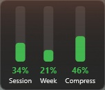
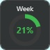
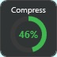
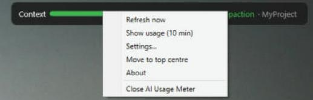
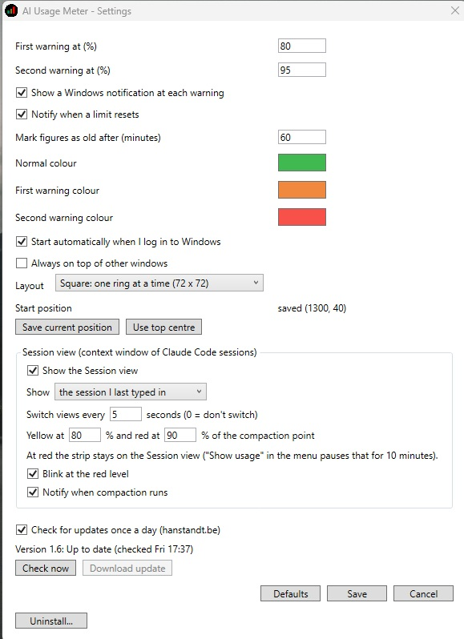

# AI Usage Meter

A small always-on-top strip for Windows that shows your Claude 5-hour and weekly usage limits while you work, and how full the context window of your Claude Code sessions is. Works with Claude Code, in the desktop app and in the terminal.

> Unofficial community project. Not affiliated with, endorsed by or sponsored by Anthropic. "Claude" is a trademark of Anthropic.


Made by Hans Tandt. MIT licence.

## What it does

- Shows how much of the 5-hour and the weekly limit you have used, and when each resets.
- Turns orange from 80% and red from 95%, and shows a Windows notification at each level. Both levels and the colours can be changed.
- Notifies you when a limit resets.
- Warns `· 100% in 1h 20m` when, at your pace so far in this window, you would hit 100% before the reset.
- Tells you when the figures are old: `· updated 3h ago`, with the bars dimmed.
- Stays on top of other windows (or not, if you switch that off); drag it anywhere and save that spot as its start position.

It only reads the usage figures that Claude Code itself reports. It does not read your Claude login or any credentials, and it never sends your data anywhere. Its only network use is an optional update check, once a day, which reads [a small version file](package/latest.json) from `https://hanstandt.be/projects/ai-usage-meter/latest.json`. When a newer version exists, the strip shows `· update 1.5` and Settings offers "Download update", which opens the download page in your browser. Nothing is downloaded or installed automatically. Switch the check off in Settings.

**Why figures can be old:** they refresh only when a Claude Code session starts or replies. Usage in the Chat tab counts toward the same limits but doesn't update the strip, so after 10 minutes the strip shows the age of its figures, and after 60 minutes (adjustable) it dims them.

## Session view (version 1.5)

Besides your 5-hour and weekly limits, the strip shows how full the **context window** of your Claude Code sessions is. When a window fills up, Claude Code compacts it: older parts of the conversation become a summary, and Claude may forget paths, rules and decisions. The Session view warns you in time to write your session notes and start a new session.

- The strip alternates between the **Usage view** (5h and Week) and the **Session view**: `Context [bar] 72% to compaction · MyProject (+2)`, with the bar using the full width of the strip. It switches every 10 seconds; set 0 to 99 seconds in Settings (0 = don't switch).
- The percentage is measured against the point where compaction starts, not the full window, because compaction starts before the window is full. If Claude Code can't report that point, the strip uses the full window and says `of window` instead of `to compaction`.
- **Green** below 80 %. **Yellow** from 80 %: a notification says to finish the task and update your session notes. **Red** from 90 %: the strip stops switching, stays on the Session view, blinks and says `Start a new session`, with a notification. "Show usage (10 min)" in the right-click menu pauses that for 10 minutes so you can still see your 5h and Week figures.
- When compaction runs, a notification says so.
- With several sessions, it shows the one you last typed in (or the fullest one, in Settings). `(+2)` means two more sessions are live; hover for a list. If another session is at red, the Session view adds `· other: <folder> 92%`.
- Each session writes its own small file in `%USERPROFILE%\.claude\usage-meter-context\`. The strip ignores sessions that ended or have been quiet for 12 hours, and deletes files older than 7 days.
- It sees **Claude Code sessions on this PC only**, in the desktop app and in the terminal. Cloud sessions (Cowork tasks that run in the cloud), sessions inside WSL and sessions on other computers over SSH are not seen, because the add-on runs only where Claude Code runs on this PC, with this Windows user's settings.


All levels, the switch time, blinking and the compaction notification can be changed in Settings.

## Layouts (version 1.6)

Choose the layout in Settings:

- **Horizontal** (default): the strip described above. It alternates between the Usage view and the Session view.
- **Vertical**: a narrow, tall panel with three bars standing side by side, filling from the bottom up: **Session** (5-hour limit), **Week** and **Compress** (context window, against the compaction point), each with its percentage. All three are visible at once.
- **Square**: 72 x 72 pixels, three times a Windows taskbar icon. It shows one figure at a time as a ring with the percentage in the middle and the title on top, in the order **Session → Week → Compress**, each for the switch time set in Settings. At the red level of the context window it stays on Compress (blinking), until "Show usage (10 min)".

 &nbsp;   

The colours, levels, warnings and notifications are the same in every layout. In the vertical and square layouts, hover over a figure for the details: reset time, pace, how old the figures are, and the list of sessions.

## Requirements

- Windows 10 or 11.
- A Claude plan with usage limits (Pro or Max).
- A recent Claude Code: the add-on uses Claude Code's function-hook plugins. The desktop app updates itself. For the terminal, check with `claude --version` and update with `claude update`; an old terminal version doesn't load the add-on, so its sessions don't appear on the strip.

## How it works

Two parts:

1. **A Claude Code add-on** ([hooks/register.tsx](hooks/register.tsx)). After each reply it writes the rate-limit windows, with the time, to `%USERPROFILE%\.claude\usage-meter.json`, and the session's context fill to its own file in `%USERPROFILE%\.claude\usage-meter-context\`. It also notes when you send a message, when compaction runs and when the session ends. Every write is wrapped so the add-on can never break a Claude session.
   It adds `/usage-demo` to preview the strip without spending usage: `/usage-demo 85` (5h and Week), `/usage-demo context 85` (Session view; add a name for a second demo session, e.g. `/usage-demo context 40 A`), and `/usage-demo off`.
2. **The strip** ([overlay/src/AIUsageMeter.cs](overlay/src/AIUsageMeter.cs)). A small WPF program that redraws every second, reads the session files every 3 seconds, and draws the bars. It keeps the readings of the current 5-hour and weekly windows in memory to estimate your pace.

## Using it

Drag the strip to move it. Right-click it, or the tray icon near the clock, for the menu (Refresh now, Show usage (10 min), Settings, Move to top centre, About, Close):



**Refresh now** re-reads the figures at once; if they are still old, a notification tells you to send Claude Code a message.

**Show usage (10 min)** shows the 5h and Week bars again when a session at the red level holds the strip on the Session view, and stops the blinking for 10 minutes.

**Settings** sets:
- both warning levels, notifications and the reset notification;
- when figures count as old;
- the three colours;
- whether the strip starts when you log in and whether it stays on top of other windows;
- the layout: horizontal, vertical or square;
- its start position (drag the strip where you want it, then "Save current position");
- the daily update check;
- the Session view: on or off, which session it shows (the one you last typed in, or the fullest), the switch time (0 to 99 seconds), the yellow and red levels, blinking and the compaction notification.



If you close the strip, start it again from the Start menu ("AI Usage Meter") or double-click the tray icon.

## Building from source

Everything builds with tools that ship with Windows 10/11; nothing needs installing, and no PowerShell is involved. In the repository all code is in the `source\` folder; run these from there.

```bat
overlay\build.cmd
```

This compiles `overlay\AIUsageMeter.exe` with the .NET Framework 4 C# compiler in `%WINDIR%\Microsoft.NET\Framework64\v4.0.30319`.

To build the release zip (exe, add-on, README, licence, screenshots, source, and `SHA256SUMS.txt`):

```bat
package\make-package.cmd
```

The zip and its unpacked folder go to `dist\`, next to `source\`.

## Installing

There is no separate installer: the program installs itself. Unzip the release and double-click `AIUsageMeter.exe`. When it finds the `plugin` folder next to itself, it lists what it will change and asks whether to install.

**What installing changes on your PC:**

1. Copies `AIUsageMeter.exe` and the add-on to `%LOCALAPPDATA%\AIUsageMeter`.
2. Adds that add-on folder to `CLAUDE_CODE_PLUGIN_DIRS` in `%USERPROFILE%\.claude\settings.json`, after saving a backup as `settings.json.bak-usage-meter`. Everything else in that file is kept.
3. Adds "AI Usage Meter" to the Start menu.
4. Lists it in Windows Settings > Apps > Installed apps (a per-user entry under `HKEY_CURRENT_USER\Software\Microsoft\Windows\CurrentVersion\Uninstall\AIUsageMeter`; no admin rights needed).

It does not start the program at login unless you switch that on in Settings.

**Uninstall:** from Windows Settings > Apps > Installed apps, or right-click the strip > Settings > Uninstall. Both remove the shortcuts, the Installed apps entry, the add-on entry in your Claude settings and the program's own settings, then open `%LOCALAPPDATA%` so you can delete the `AIUsageMeter` folder.

**The exe is not code-signed**, so Windows SmartScreen may warn. Each release lists the SHA-256 checksum in its notes and in `SHA256SUMS.txt`; check yours with `certutil -hashfile AIUsageMeter.exe SHA256`, or build the exe yourself from this source.

## Releasing a new version

The program checks `https://hanstandt.be/projects/ai-usage-meter/latest.json` once a day. The file looks like this ([package/latest.json](package/latest.json)):

```json
{
  "version": "1.5.1",
  "url": "https://hanstandt.be/projects/ai-usage-meter/"
}
```

- `version`: the newest released version. When it is higher than the installed one, the strip shows `· update <version>`.
- `url`: the download page that "Download update" opens. It must be on the same site as the version file (hanstandt.be); otherwise the program opens the folder of the version file instead.

To release a new version:

1. Raise the version number in `overlay/src/AIUsageMeter.cs` (`Program.Version` and the two `Assembly...Version` lines), `.claude-plugin/plugin.json` and the first line of `package/README.txt`.
2. Build the zip with `package\make-package.cmd`. It prints the SHA-256 checksum of the exe and saves it in `SHA256SUMS.txt`.
3. Put the new zip on the download page, with its checksum.
4. **Only then** change `version` in `latest.json` on the website. Within a day, every running copy with update checks switched on shows the update. Changing it before the zip is online would send people to a page without the new version.
5. Change `version` in `package/latest.json` in the repo too, so it matches the website.

People update by unzipping the new version and double-clicking `AIUsageMeter.exe`: it installs over the old one and keeps their settings.

## Files

| Path | What it is |
| --- | --- |
| `hooks/register.tsx` | The Claude Code add-on |
| `types/index.d.ts` | The add-on's data types (usage windows, session files) |
| `overlay/src/AIUsageMeter.cs` | The strip program, including install and uninstall |
| `overlay/build.cmd` | Builds the exe |
| `package/README.txt` | The README that goes in the zip |
| `package/make-package.cmd` | Builds the zip and checksum |
| `package/latest.json` | The version file to upload to the website |
| `docs/content_XX.json` | The manual's text in EN, FR, NL and DE (built with the general-report-builder skill) |
| `docs/make_figures.py` | Builds the manual's figures in each language |
| `docs/out/AI_Usage_Meter_Manual_XX.pdf` / `.docx` | The manuals; the PDFs go into the zip's `manual` folder |

Settings are stored in `%USERPROFILE%\.claude\usage-meter-settings.json`; the usage figures in `usage-meter.json` and the session files in `usage-meter-context\`, in the same folder.

## Licence

MIT, © 2026 Hans Tandt. See [LICENSE](LICENSE).
